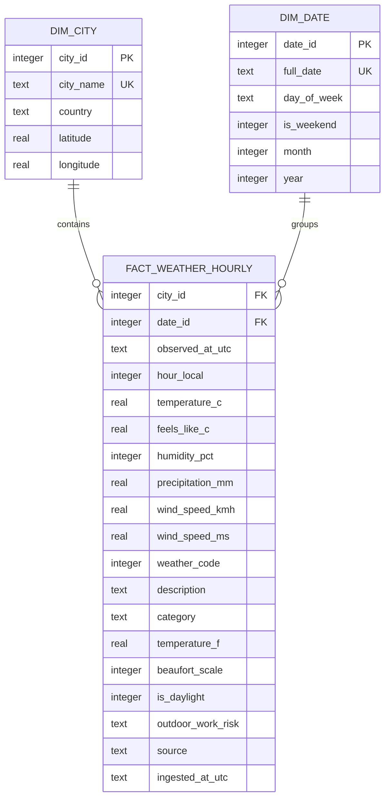

# WeatherFlow Star Schema

## Grain

One row per city, per hour, per source.

Each fact row represents one hourly weather observation from a configured city
and a specific data source. The composite primary key is
`(city_id, observed_at_utc, source)`.

## Date convention

`date_id` uses the local Europe/London calendar date. It is derived from
`observed_at_local`, not `observed_at_utc`. This ensures that a UTC reading near
midnight is assigned to the correct UK business date.

The `dim_date.date_id` value is stored as an integer in `YYYYMMDD` format.

## Entity relationship diagram

## Natural and surrogate keys

- `city_name` is the natural city key and is used in configuration and validation.
- `city_id` is the surrogate key assigned to `dim_city` by SQLite.
- `date_id` is a business-safe integer surrogate derived from the local date.
- `source` distinguishes measurements produced by different weather sources.
